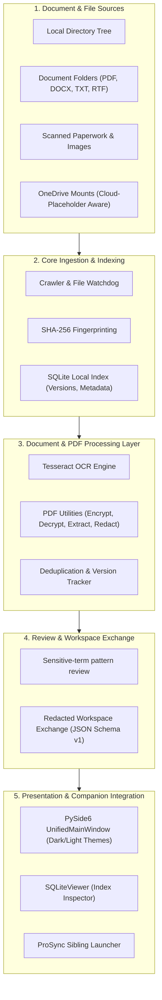
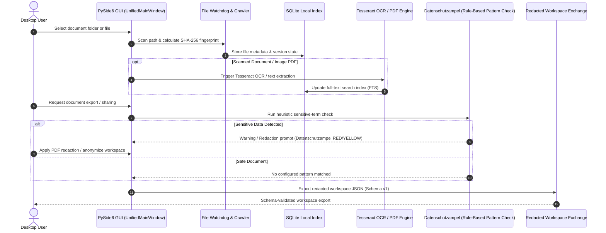
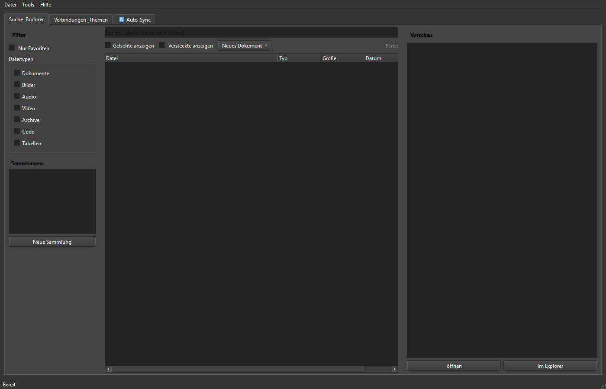

# ProFiler Suite

**[English](README.md)** | [Deutsch](README_de.md) | [GitHub](https://github.com/file-bricks/ProFiler)

[](CHANGELOG.md)
[](https://github.com/file-bricks)
[](LICENSE)
[](https://github.com/file-bricks/ProFiler/actions/workflows/source-platform-smoke.yml)
[](CHANGELOG.md)
[](https://github.com/astral-sh/ruff)
[](CONTRIBUTING.md)
[](NOTICE)
[](https://www.python.org/)
[](https://wiki.qt.io/Qt_for_Python)
[](https://github.com/open-bricks)
[](llms.txt)
[](CHANGELOG.md)


> [!NOTE]
> AI agents and LLM tools reading this repository should refer to [`llms.txt`](llms.txt) for codebase architecture, primary features, contract boundaries, and verification commands.

> Local-first document detective — full-text indexing, OCR, PDF tools, duplicate detection & privacy checks in one PySide6 app.

ProFiler Suite is a Windows-oriented PySide6 desktop app for indexing user-selected local folders, OCR, PDF workflows, SHA-256 duplicate detection, and sensitive-term review. Its indexes and application settings are stored locally; their exact locations depend on configuration and operating system. The source also contains an optional, user-invoked GitHub module installer. The reviewed first-party paths showed no automatic upload of document contents or telemetry; the application does not block network traffic or control the operating system and external libraries.

ProFiler can help users work with local or user-selected files. Review results and redactions before sharing. The module installer can contact GitHub when explicitly invoked; ProFiler is not an egress filter or a compliance/privacy certification.

---

### Quick Navigation

1. [Architecture](#architecture)
2. [Workflow Lifecycle](#workflow-lifecycle)
3. [Core Capabilities & Security Invariants](#core-capabilities--security-invariants)
4. [Target Personas & Use Cases](#target-personas--use-cases)
5. [Comparative Matrix & Alternatives](#comparative-matrix--alternatives)
6. [Feature Highlights](#feature-highlights)
7. [Visual Interface & Screenshot](#visual-interface--screenshot)
8. [When To Use ProFiler](#when-to-use-profiler)
9. [Quick Start & Setup](#quick-start--setup)
10. [Windows Launcher & Build Flow](#windows-launcher--build-flow)
11. [Configuration & Local Storage](#configuration--local-storage)
12. [Included Tools & Utilities](#included-tools--utilities)
13. [Supported File Formats & OCR](#supported-file-formats--ocr)
14. [Sibling Ecosystem & Integrations](#sibling-ecosystem--integrations)
15. [Third-Party Licenses](#third-party-licenses--compliance)
16. [Security Policy](#security-policy--slas)
17. [Target Personas & High-Intent SEO](#target-personas--high-intent-seo)
18. [Verification & Test Suite](#verification--test-suite)

---

<a id="sec-01"></a>
<a id="1-architecture"></a>
<a id="architecture"></a>
<a id="1-architektur"></a>
<a id="architektur"></a>
## Architecture



<a id="sec-02"></a>
<a id="2-workflow-lifecycle"></a>
<a id="workflow-lifecycle"></a>
<a id="2-workflow-lebenszyklus"></a>
<a id="workflow-lebenszyklus"></a>
## Workflow Lifecycle



<a id="sec-03"></a>
<a id="3-core-capabilities--security-invariants"></a>
<a id="core-capabilities--security-invariants"></a>
<a id="3-kernfähigkeiten--sicherheitsinvarianten"></a>
<a id="kernfähigkeiten--sicherheitsinvarianten"></a>
## Core Capabilities & Security Invariants

| Area | Supported behavior | Boundary |
|---|---|---|
| Local storage | Application settings and search indexes are stored under the user profile by default; paths are configurable. | Local-first describes processing, not a network block. The optional module installer uses GitHub when invoked. |
| PDF passwords | The application does not persist PDF passwords in its settings; targeted regression tests cover this behavior. | This does not establish a general guarantee for every secret or external process. |
| Privacy review | Rule- and pattern-based checks flag possible sensitive terms and numbers. | This is not complete PII detection, legal review, or a GDPR compliance assessment; users should review matches and redactions. |
| Workspace exchange | Export uses a JSON schema and filters selected local paths and keys. | It is a limited interchange format, not a general guarantee that an archive is anonymous or risk-free. |
| OCR and PDF | Tesseract and Poppler can support OCR and PDF rendering when those external tools are available. | Source smoke tests do not verify complete native bundling, WACK certification, or Store distribution. |
| Permissions | ProFiler stores configuration under the user profile and runs with the calling process permissions. | No sandbox, egress block, or privilege drop is claimed.


<a id="sec-04"></a>
<a id="4-target-personas--use-cases"></a>
<a id="target-personas--use-cases"></a>
<a id="4-zielgruppen--anwendungsfälle"></a>
<a id="zielgruppen--anwendungsfälle"></a>
## Target Personas & Use Cases

| Audience | Common task | Product boundary |
|---|---|---|
| **People working with sensitive files** | Search local documents and review pattern warnings before sharing. | The privacy checker is a rule-based aid, not complete personal-data detection or a legal/compliance review. |
| **Researchers and archives** | Index scans, search documents, and identify duplicates. | OCR needs the required external tools; source smoke tests do not certify a complete native distribution. |
| **Small offices and freelancers** | Organize invoices, contracts, and receipts locally and perform selected PDF operations. | Whether files remain local also depends on storage locations, operating-system services, and external components. |
| **Power users** | Work with folders, indexes, previews, keyboard operations, and optional sibling tools. | ProFiler does not control permissions of other processes or synchronization services.


<a id="sec-05"></a>
<a id="5-comparative-matrix--alternatives"></a>
<a id="comparative-matrix--alternatives"></a>
<a id="5-vergleichsmatrix--alternativen"></a>
<a id="vergleichsmatrix--alternativen"></a>
## Comparative Matrix & Alternatives

ProFiler focuses on local file management, search indexes, and selected OCR/PDF workflows. The projects below serve different workflows; this table does not claim a feature or security assessment of them.

| Workflow | Context |
|---|---|
| Local document search | ProFiler indexes user-selected folders and stores its search index locally. |
| Notes and LLM-assisted search | [KnowledgeDigest](https://github.com/file-bricks/knowledgedigest) is a separate tool; a ProFiler integration is not established. |
| Batch OCR and PDF preparation | [PDFtoPDFocr](https://github.com/doc-bricks/PDFtoPDFocr) and [DokuZen](https://github.com/doc-bricks/DokuZen) are separate tools with different focuses. |
| General file management or cloud DMS | Operation, privacy, cost, and features vary by product and configuration; consult each product’s documentation.


<a id="sec-06"></a>
<a id="6-feature-highlights"></a>
<a id="feature-highlights"></a>
<a id="6-funktions-highlights"></a>
<a id="funktions-highlights"></a>
## Feature Highlights

- **Local SQLite File Index**: Rapid indexing for folders, document collections, and versioned file entries.
- **Full-Text Search Engine**: Search across PDF, DOCX, TXT, RTF, images, spreadsheets, and source code.
- **Tesseract OCR Integration**: Automatic OCR workflow for scanned PDFs and image documents.
- **Comprehensive PDF Workshop**: Encrypt, decrypt, extract pages, redact text, and export sanitized documents.
- **Cryptographic Deduplication**: Fast SHA-256 fingerprinting to identify redundant duplicate files.
- **Privacy review**: Rule-based warnings for possible sensitive terms before sharing; inspect results manually.
- **Cloud-placeholder handling**: The crawler recognizes supported placeholder states; behavior depends on platform and file system.
- **ProSync Companion Integration**: Direct launcher bridge for synchronizing managed folder pairs.
- **Redacted Workspace Exchange**: Export and import portable workspaces via JSON Schema v1.
- **Ergonomic Desktop UI**: Native PySide6 interface with dark/light theme switching and system tray integration.
- **Companion Utilities**: Bundled SQLite database inspector (`SQLiteViewer.py`) and Excel file importer.

<a id="sec-07"></a>
<a id="7-visual-interface--screenshot"></a>
<a id="visual-interface--screenshot"></a>
<a id="7-visuelle-oberfläche--screenshot"></a>
<a id="visuelle-oberfläche--screenshot"></a>
## Visual Interface & Screenshot



<a id="sec-08"></a>
<a id="8-when-to-use-profiler"></a>
<a id="when-to-use-profiler"></a>
<a id="8-wann-profiler-passt"></a>
<a id="wann-profiler-passt"></a>
## When To Use ProFiler

ProFiler is the optimal solution when you require a private document management tool for:

- Maintaining searchable local archives of PDFs, Office documents, text files, and scanned receipts.
- Running OCR-assisted indexing on scans when required local tools are available.
- Detecting duplicate files and auditing version drift across deep directory structures.
- Handling PDF security operations (passwords, page extractions, redactions) in a single desktop app.
- Reviewing possible sensitive terms before sharing; this is not a legal or compliance assessment.
- Optionally launching the separate [ProSync](https://github.com/file-bricks/ProSync) tool from the menu; SQLiteViewer is a separate script in this repository.

<a id="sec-09"></a>
<a id="9-quick-start--setup"></a>
<a id="quick-start--setup"></a>
<a id="9-schnellstart--installation"></a>
<a id="schnellstart--installation"></a>
## Quick Start & Setup

### Prerequisites & Requirements

- Python 3.11+ (required by Pillow 13; see the current CI scope below)
- PySide6
- Tesseract OCR (optional, required for image and scanned PDF OCR)
- Poppler utilities (optional, required for PDF rendering and page conversion)

### Installation & Launch

Install runtime dependencies from PyPI:

```bash
pip install -r requirements.txt
python Profiler_Suite_V15.py
```

On Windows, you can start the application directly via the bundled starter script:

```bat
START.bat
```

<a id="sec-10"></a>
<a id="10-windows-launcher--build-flow"></a>
<a id="windows-launcher--build-flow"></a>
<a id="10-windows-launcher--build-prozess"></a>
<a id="windows-launcher--build-prozess"></a>
## Windows Launcher & Build Flow

To attempt a local Windows executable build, run:

```bat
build_exe.bat
```

The script stops before PyInstaller unless the required files exist under `runtime/tesseract/` and `runtime/poppler/`. It requires a clean Git checkout and uses `BUILD_ROOT` as a configurable local output directory.

When prerequisites are present, outputs include:

- `<BUILD_ROOT>/dist/ProFiler.exe`
- `<BUILD_ROOT>/release/SHA256SUMS.txt`
- `<BUILD_ROOT>/release/BUILD-PROVENANCE.json`

This is a local build flow. The script does not publish to GitHub Releases, OneDrive, or the Microsoft Store.


<a id="sec-11"></a>
<a id="11-configuration--local-storage"></a>
<a id="configuration--local-storage"></a>
<a id="11-konfiguration--lokale-ablage"></a>
<a id="konfiguration--lokale-ablage"></a>
## Configuration & Local Storage

| File Path | Functional Purpose |
|---|---|
| `%LOCALAPPDATA%\ProFilerSuite\profiler_config.json` | Active folder connections and database indexing settings |
| `%LOCALAPPDATA%\ProFilerSuite\profiler_settings.json` | UI preferences, theme selection, and optional tool paths |
| `%LOCALAPPDATA%\ProFilerSuite\search_config.json` | Configured search databases and indexing targets |
| `*.example.json` | Public, path-free configuration templates (never contain live data) |

PDF passwords are session-only and are deliberately excluded from persisted settings. The Excel importer is an optional administrative utility:

```bash
python -m pip install -e ".[excel]"
python import_excel_to_profiler.py --input INPUT.xlsx --database profiler.db --output imported
```

<a id="sec-12"></a>
<a id="12-included-tools--utilities"></a>
<a id="included-tools--utilities"></a>
<a id="12-enthaltene-werkzeuge--dienstprogramme"></a>
<a id="enthaltene-werkzeuge--dienstprogramme"></a>
## Included Tools & Utilities

| Tool File | Functional Description |
|---|---|
| `Profiler_Suite_V15.py` | Main desktop GUI application (PySide6) |
| `ProFiler_Datenschutzampel.py` | Standalone rule-based checks for possible sensitive terms; not complete PII detection |
| `SQLiteViewer.py` | SQLite database viewer for inspecting index tables |
| `import_excel_to_profiler.py` | Command-line utility for importing existing Excel file inventories |
| `indent_gui_checker.py` | Codebase development tool for checking GUI indentation integrity |

<a id="sec-13"></a>
<a id="13-supported-file-formats--ocr"></a>
<a id="supported-file-formats--ocr"></a>
<a id="13-unterstützte-dateiformate--ocr"></a>
<a id="unterstützte-dateiformate--ocr"></a>
## Supported File Formats & OCR

| Category | File Extensions | Capabilities |
|---|---|---|
| **Documents** | `.pdf`, `.docx`, `.txt`, `.rtf` | Full-text indexing, metadata parsing, search, and preview |
| **Images** | `.png`, `.jpg`, `.jpeg`, `.tiff`, `.bmp` | Metadata extraction, image preview, and Tesseract OCR text recognition |
| **Spreadsheets** | `.xlsx`, `.xls`, `.csv` | Structure inspection and metadata indexing (Excel extra available) |
| **Other Formats** | Universal fallback | Indexed by filesystem attributes, file size, timestamps, and SHA-256 hash |

<a id="sec-14"></a>
<a id="14-sibling-ecosystem--integrations"></a>
<a id="sibling-ecosystem--integrations"></a>
<a id="14-geschwister-ökosystem--integrationen"></a>
<a id="geschwister-ökosystem--integrationen"></a>
## Sibling Ecosystem & Related Tools

ProFiler is part of the file-bricks tool family under the [open-bricks](https://github.com/open-bricks) umbrella. A link does not imply a technical integration.

| Tool | Repository | Established relationship |
|---|---|---|
| **ProSync** | [file-bricks/ProSync](https://github.com/file-bricks/ProSync) | Can be started as a separate program from an optional ProFiler menu item. Sync runs outside ProFiler. |
| **SQLiteViewer** | [SQLiteViewer.py](SQLiteViewer.py) | Separate script in this repository for viewing SQLite databases. |
| **KnowledgeDigest** | [file-bricks/knowledgedigest](https://github.com/file-bricks/knowledgedigest) | Independent family tool for notes and knowledge search; no direct ProFiler integration established. |
| **PDFtoPDFocr** | [doc-bricks/PDFtoPDFocr](https://github.com/doc-bricks/PDFtoPDFocr) | Separate tool for batch OCR and searchable PDFs. |
| **DokuZen** | [doc-bricks/DokuZen](https://github.com/doc-bricks/DokuZen) | Separate desktop tool for PDF workflows. |
| **MediaBrain** | [doc-bricks/MediaBrain](https://github.com/doc-bricks/MediaBrain) | Independent video/music library with playlists and history; no ProFiler integration established. |

Find other organization projects at [file-bricks](https://github.com/file-bricks).


<a id="sec-15"></a>
<a id="15-third-party-licenses--compliance"></a>
<a id="third-party-licenses--compliance"></a>
<a id="15-drittanbieter-lizenzen--compliance"></a>
<a id="drittanbieter-lizenzen--compliance"></a>
## Third-Party Licenses

ProFiler itself is licensed under **AGPL-3.0-only**; see [LICENSE](LICENSE).

[THIRD_PARTY_LICENSES.md](THIRD_PARTY_LICENSES.md) and [THIRD_PARTY_LICENSES.txt](THIRD_PARTY_LICENSES.txt) list declared direct runtime and optional dependencies plus selected development/build tools, with links to upstream license sources. This is not a complete inventory of transitive packages or bundled binaries and is not a license-compatibility or legal review.

Before distributing a binary or Store package, review the actual artifacts, bundled components, license texts, and bundling terms separately. Existing Store files are preparation material and do not establish publication or certification.


<a id="sec-16"></a>
<a id="16-security-policy--slas"></a>
<a id="security-policy--slas"></a>
<a id="16-sicherheitsrichtlinie--slas"></a>
<a id="sicherheitsrichtlinie--slas"></a>
## Security Policy

ProFiler accepts private reports about security issues. When available, use [GitHub Security Advisories](https://github.com/file-bricks/ProFiler/security/advisories/new). If that route is unavailable, use the alternative contact and process in [SECURITY.md](SECURITY.md).

No fixed response, triage, or remediation timelines are promised. Investigation and fixes depend on reproducibility, severity, and maintainer availability.


<a id="sec-17"></a>
<a id="17-target-personas--high-intent-seo"></a>
<a id="target-personas--high-intent-seo"></a>
<a id="17-zielgruppen--high-intent-seo"></a>
<a id="zielgruppen--high-intent-seo"></a>
## Target Users & Search Terms

ProFiler is for people who organize local documents and want to review possible sensitive terms before sharing. Its pattern checks do not assess legal requirements or establish GDPR compliance.

| Audience | Example need | Search terms |
|---|---|---|
| **People with sensitive files** | Review terms and patterns in selected files before sharing. | `local document privacy review`, `desktop PDF redaction` |
| **Researchers and archives** | Index scans, run OCR, and identify duplicates. | `desktop PDF OCR`, `local full-text document search` |
| **Small offices and freelancers** | Organize invoices, contracts, and receipts. | `local document manager`, `SQLite desktop file index` |
| **Power users** | Work with local folders, previews, and optional separate sibling tools. | `PySide6 file management`, `SQLite document search` |

These terms describe workflows, not privacy, legal, or security certification.


<a id="sec-18"></a>
<a id="18-verification--test-suite"></a>
<a id="verification--test-suite"></a>
<a id="18-verifikation--test-suite"></a>
<a id="verifikation--test-suite"></a>
## Verification & Test Suite

Run local development checks with:

```bash
python -m pytest -ra -v
ruff check .
python -m compileall -q .
git diff --check
python source_platform_smoke.py
```

The [`source-platform-smoke.yml`](.github/workflows/source-platform-smoke.yml) workflow runs compilation, the basis smoke, Linux/macOS smokes, and pytest on Ubuntu and macOS with Python 3.11. This does not establish Windows CI, the presence of OCR/Poppler binaries, native packaging, tray behavior, or Microsoft Store/WACK approval. Check current results in the [Actions tab](https://github.com/file-bricks/ProFiler/actions/workflows/source-platform-smoke.yml) for the exact commit.

The privacy checker is a rule-based aid; review matches and any PDF redactions before sharing. ProFiler does not provide legal advice.
