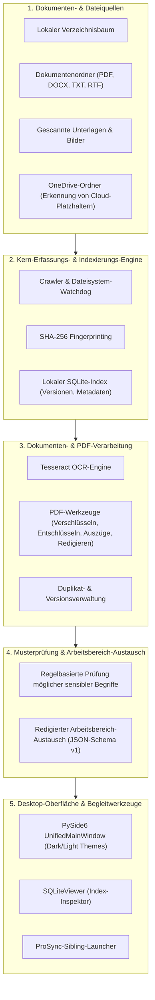
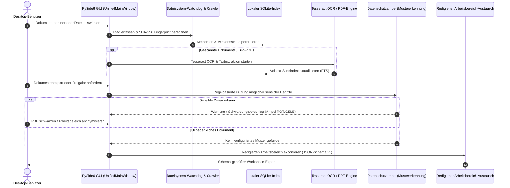

# ProFiler Suite

[English](README.md) | **[Deutsch](README_de.md)** | [GitHub](https://github.com/file-bricks/ProFiler)

[](CHANGELOG.md)
[](https://github.com/file-bricks)
[](LICENSE)
[](https://github.com/file-bricks/ProFiler/actions/workflows/source-platform-smoke.yml)

[](https://github.com/astral-sh/ruff)
[](CONTRIBUTING.md)


[](NOTICE)
[](https://www.python.org/)
[](https://wiki.qt.io/Qt_for_Python)


[](https://github.com/open-bricks)
[](llms.txt)


> [!NOTE]
> KI-Agenten und LLM-Tools, die dieses Repository analysieren, finden in [`llms.txt`](llms.txt) Details zur Architektur, zu primären Features, Vertragsschnittstellen und Verifikationsbefehlen.

> Lokaler Dokumenten-Detektiv — Volltext-Indexierung, OCR, PDF-Werkzeuge, Duplikaterkennung & Datenschutzprüfung in einer PySide6-App.

ProFiler Suite ist eine Windows-orientierte PySide6-Desktop-App zum Indexieren vom Nutzer ausgewählter lokaler Ordner, für OCR- und PDF-Arbeitsabläufe, SHA-256-Deduplizierung und Hinweise auf mögliche sensible Begriffe. Suchindizes und App-Einstellungen werden lokal gespeichert; der konkrete Pfad hängt von Konfiguration und Betriebssystem ab. Der Quellcode enthält außerdem einen optionalen, vom Nutzer gestarteten GitHub-Modulinstaller. In den geprüften First-Party-Pfaden wurde kein automatischer Upload von Dokumentinhalten und keine Telemetrie gefunden. ProFiler blockiert jedoch keinen Netzwerkverkehr und kontrolliert weder Betriebssystem noch externe Bibliotheken.

ProFiler unterstützt lokale Such-, Vorschau- und PDF-Arbeitsabläufe für vom Nutzer ausgewählte Dateien. Prüfe Ergebnisse und Schwärzungen vor einer Weitergabe selbst. Der Modulinstaller kann bei ausdrücklichem Aufruf GitHub kontaktieren; ProFiler ist kein Egress-Filter und keine Datenschutz- oder Compliance-Zertifizierung.

---

### Schnellnavigation

1. [Architektur](#architektur)
2. [Workflow-Lebenszyklus](#workflow-lebenszyklus)
3. [Kernfähigkeiten & Sicherheitsinvarianten](#kernfähigkeiten--sicherheitsinvarianten)
4. [Zielgruppen & Anwendungsfälle](#zielgruppen--anwendungsfälle)
5. [Vergleichsmatrix & Alternativen](#vergleichsmatrix--alternativen)
6. [Funktions-Highlights](#funktions-highlights)
7. [Visuelle Oberfläche & Screenshot](#visuelle-oberfläche--screenshot)
8. [Wann ProFiler passt](#wann-profiler-passt)
9. [Schnellstart & Installation](#schnellstart--installation)
10. [Windows-Launcher & Build-Prozess](#windows-launcher--build-prozess)
11. [Konfiguration & Lokale Ablage](#konfiguration--lokale-ablage)
12. [Enthaltene Werkzeuge & Dienstprogramme](#enthaltene-werkzeuge--dienstprogramme)
13. [Unterstützte Dateiformate & OCR](#unterstützte-dateiformate--ocr)
14. [Geschwister-Ökosystem & Integrationen](#geschwister-ökosystem--integrationen)
15. [Drittanbieter-Lizenzen](#drittanbieter-lizenzen--compliance)
16. [Sicherheitsrichtlinie](#sicherheitsrichtlinie--slas)
17. [Zielgruppen & High-Intent SEO](#zielgruppen--high-intent-seo)
18. [Verifikation & Test-Suite](#verifikation--test-suite)

---

<a id="sec-01"></a>
<a id="1-architektur"></a>
<a id="architektur"></a>
<a id="1-architecture"></a>
<a id="architecture"></a>
## Architektur



<a id="sec-02"></a>
<a id="2-workflow-lebenszyklus"></a>
<a id="workflow-lebenszyklus"></a>
<a id="2-workflow-lifecycle"></a>
<a id="workflow-lifecycle"></a>
## Workflow-Lebenszyklus



<a id="sec-03"></a>
<a id="3-kernfähigkeiten--sicherheitsinvarianten"></a>
<a id="kernfähigkeiten--sicherheitsinvarianten"></a>
<a id="3-core-capabilities--security-invariants"></a>
<a id="core-capabilities--security-invariants"></a>
## Kernfähigkeiten & Sicherheitsinvarianten

| Bereich | Belegte Funktion | Grenze |
|---|---|---|
| Lokale Ablage | App-Einstellungen und Suchindizes liegen standardmäßig im Benutzerprofil; Pfade lassen sich konfigurieren. | Local-first beschreibt die Verarbeitung, keine Netzwerksperre. Der optionale Modulinstaller nutzt GitHub, wenn er aufgerufen wird. |
| PDF-Passwörter | Die Anwendung speichert PDF-Passwörter nicht in den Einstellungen; dafür gibt es gezielte Regressionstests. | Daraus folgt keine allgemeine Aussage über alle Geheimnisse oder externe Prozesse. |
| Datenschutzampel | Regel- und musterbasierte Prüfung markiert mögliche sensible Begriffe und Nummern. | Keine vollständige PII-Erkennung, Rechtsprüfung oder DSGVO-Konformitätsbewertung; Treffer und Schwärzungen müssen geprüft werden. |
| Workspace-Austausch | Der Export nutzt ein JSON-Schema und filtert bestimmte lokale Pfade und Schlüssel. | Ein begrenztes Austauschformat, keine allgemeine Garantie für ein anonymes oder risikofreies Archiv. |
| OCR und PDF | Tesseract und Poppler können für OCR und PDF-Rendering verwendet werden, wenn die externen Werkzeuge verfügbar sind. | Die Source-Smokes prüfen keine vollständige native Bündelung, WACK-Zertifizierung oder Store-Verteilung. |
| Berechtigungen | ProFiler legt Konfiguration unter dem Benutzerprofil ab und läuft mit den Berechtigungen des aufrufenden Prozesses. | Es gibt keine bestätigte Sandbox, Egress-Sperre oder Privilegienabsenkung.


<a id="sec-04"></a>
<a id="4-zielgruppen--anwendungsfälle"></a>
<a id="zielgruppen--anwendungsfälle"></a>
<a id="4-target-personas--use-cases"></a>
<a id="target-personas--use-cases"></a>
## Zielgruppen & Anwendungsfälle

| Zielgruppe | Typische Aufgaben | Passende Einordnung |
|---|---|---|
| **Nutzer mit sensiblen Unterlagen** | Lokale Dokumente durchsuchen und Musterwarnungen vor einer Freigabe prüfen. | Die Datenschutzampel ist eine regelbasierte Hilfe, keine vollständige Erkennung personenbezogener Daten und keine Rechts- oder Compliance-Prüfung. |
| **Forschung und Archive** | Scans indexieren, Dokumente durchsuchen und Dubletten finden. | OCR benötigt passende externe Werkzeuge; die angebotenen Source-Smokes zertifizieren keine vollständige native Bereitstellung. |
| **Kleine Büros und Selbstständige** | Rechnungen, Verträge und Belege lokal organisieren und ausgewählte PDF-Schritte ausführen. | Ob Dateien lokal bleiben, hängt auch von Speicherorten, Betriebssystemdiensten und externen Komponenten ab. |
| **Power-User** | Ordner, Indizes, Vorschau, Tastaturfunktionen und optionale Geschwisterwerkzeuge nutzen. | ProFiler kontrolliert nicht die Berechtigungen anderer Prozesse oder Synchronisationsdienste.


<a id="sec-05"></a>
<a id="5-vergleichsmatrix--alternativen"></a>
<a id="vergleichsmatrix--alternativen"></a>
<a id="5-comparative-matrix--alternatives"></a>
<a id="comparative-matrix--alternatives"></a>
## Vergleichsmatrix & Alternativen

ProFiler konzentriert sich auf lokale Dateiverwaltung, Suchindizes und ausgewählte OCR-/PDF-Arbeitsabläufe. Die folgenden Projekte bedienen andere Arbeitsweisen; die Tabelle behauptet keine Funktions- oder Sicherheitsprüfung dieser Produkte.

| Arbeitsweise | Einordnung |
|---|---|
| Lokale Dokumentensuche | ProFiler indexiert vom Nutzer ausgewählte Ordner und speichert den Suchindex lokal. |
| Notizen und LLM-Suche | [KnowledgeDigest](https://github.com/file-bricks/knowledgedigest) ist ein separates Werkzeug; eine ProFiler-Integration ist nicht belegt. |
| Batch-OCR und PDF-Aufbereitung | [PDFtoPDFocr](https://github.com/doc-bricks/PDFtoPDFocr) und [DokuZen](https://github.com/doc-bricks/DokuZen) sind eigenständige Werkzeuge mit anderem Schwerpunkt. |
| Allgemeine Dateiverwaltung oder Cloud-DMS | Betrieb, Datenschutz, Kosten und Funktionen unterscheiden sich je nach Produkt und Konfiguration; bitte die jeweilige Produktdokumentation prüfen.


<a id="sec-06"></a>
<a id="6-funktions-highlights"></a>
<a id="funktions-highlights"></a>
<a id="6-feature-highlights"></a>
<a id="feature-highlights"></a>
## Funktions-Highlights

- **Lokaler SQLite-Dateikatalog**: Schnelle Indexierung von Verzeichnisbäumen, Sammlungen und Dateiversionen.
- **Volltext-Suchmaschine**: Durchsucht PDFs, DOCX, TXT, RTF, Bilder, Tabellen und Quellcode.
- **Tesseract-OCR-Workflow**: Automatische Texterkennung für eingescannte Bild-PDFs und Grafikformate.
- **Umfassende PDF-Werkzeuge**: Verschlüsseln, Entschlüsseln, Seiten extrahieren, Text schwärzen und bereinigen.
- **Kryptografische Duplikaterkennung**: Schneller SHA-256-Fingerprint zur Identifikation identischer Dateien.
- **Datenschutzampel**: Regelbasierte Hinweise auf mögliche sensible Begriffe; Treffer bitte selbst prüfen.
- **Cloud-Platzhalter**: Der Crawler berücksichtigt erkannte Platzhalter in unterstützten Scanpfaden; das Verhalten hängt von Plattform und Dateisystem ab.
- **ProSync-Integration**: Direkte Anbindung an das Ordnersynchronisations-Werkzeug ProSync.
- **Redigierter Arbeitsbereich-Austausch**: Export und Import portabler Workspaces über JSON-Schema v1.
- **Moderne Desktop-Oberfläche**: Native PySide6-GUI mit Dark-/Light-Theme-Umschaltung und System-Tray-Support.
- **Zusätzliche Dienstprogramme**: Integrierter SQLite-Inspektor (`SQLiteViewer.py`) und Excel-Importwerkzeug.

<a id="sec-07"></a>
<a id="7-visuelle-oberfläche--screenshot"></a>
<a id="visuelle-oberfläche--screenshot"></a>
<a id="7-visual-interface--screenshot"></a>
<a id="visual-interface--screenshot"></a>
## Visuelle Oberfläche & Screenshot


<a id="sec-08"></a>
<a id="8-wann-profiler-passt"></a>
<a id="wann-profiler-passt"></a>
<a id="8-when-to-use-profiler"></a>
<a id="when-to-use-profiler"></a>
## Wann ProFiler passt

ProFiler ist die ideale Wahl, wenn Sie ein privates Dokumentenwerkzeug benötigen für:

- Durchsuchbare lokale Archive von PDFs, Office-Dokumenten, Texten und eingescannten Belegen.
- OCR-unterstützte Volltextsuche in Scans, wenn die benötigten lokalen Werkzeuge verfügbar sind.
- Erkennung von Dateidubletten und Prüfung von Versionsständen über komplexe Ordnerstrukturen hinweg.
- Sichere PDF-Arbeiten (Passwortschutz, Auszüge, Schwärzungen) in einer einzigen lokalen Desktop-Anwendung.
- Mögliche sensible Begriffe vor der Weitergabe markieren; dies ist keine Rechts- oder DSGVO-Konformitätsprüfung.
- Das separate Werkzeug [ProSync](https://github.com/file-bricks/ProSync) optional über das Menü starten; SQLiteViewer liegt als eigenes Skript in diesem Repository.

<a id="sec-09"></a>
<a id="9-schnellstart--installation"></a>
<a id="schnellstart--installation"></a>
<a id="9-quick-start--setup"></a>
<a id="quick-start--setup"></a>
## Schnellstart & Installation

### Voraussetzungen & Systemanforderungen

- Python 3.10+ (getestet unter Python 3.10, 3.11, 3.12, 3.13)
- PySide6
- Tesseract OCR (optional, erforderlich für Bild- und Scan-OCR)
- Poppler-Dienstprogramme (optional, erforderlich für PDF-Rendering und Konvertierung)

### Installation & Ausführung

Installieren Sie die Laufzeitabhängigkeiten über PyPI:

```bash
pip install -r requirements.txt
python Profiler_Suite_V15.py
```

Unter Windows kann die Anwendung direkt über die Startdatei aufgerufen werden:

```bat
START.bat
```

<a id="sec-10"></a>
<a id="10-windows-launcher--build-prozess"></a>
<a id="windows-launcher--build-prozess"></a>
<a id="10-windows-launcher--build-flow"></a>
<a id="windows-launcher--build-flow"></a>
## Windows-Launcher & Build-Prozess

Für einen lokalen Windows-EXE-Build:

```bat
build_exe.bat
```

Das Skript bricht vor PyInstaller ab, wenn Dateien unter `runtime/tesseract/` oder `runtime/poppler/` fehlen. Außerdem benötigt es einen sauberen Git-Klon. `BUILD_ROOT` legt das konfigurierbare lokale Ausgabeverzeichnis fest.

Bei erfüllten Voraussetzungen entstehen unter anderem:

- `<BUILD_ROOT>/dist/ProFiler.exe`
- `<BUILD_ROOT>/release/SHA256SUMS.txt`
- `<BUILD_ROOT>/release/BUILD-PROVENANCE.json`

Dies ist ein lokaler Build-Ablauf. Das Skript veröffentlicht nicht bei GitHub Releases, in OneDrive oder im Microsoft Store.


<a id="sec-11"></a>
<a id="11-konfiguration--lokale-ablage"></a>
<a id="konfiguration--lokale-ablage"></a>
<a id="11-configuration--local-storage"></a>
<a id="configuration--local-storage"></a>
## Konfiguration & Lokale Ablage

| Dateipfad | Zweck & Funktion |
|---|---|
| `%LOCALAPPDATA%\ProFilerSuite\profiler_config.json` | Konfigurierte Ordnerverbindungen und Indexeinstellungen |
| `%LOCALAPPDATA%\ProFilerSuite\profiler_settings.json` | UI-Einstellungen, Design-Auswahl und optionale Werkzeugpfade |
| `%LOCALAPPDATA%\ProFilerSuite\search_config.json` | Konfigurierte Suchdatenbanken und Indexierungsziele |
| `*.example.json` | Öffentliche, pfadfreie Konfigurationsvorlagen (enthalten niemals Realdaten) |

PDF-Passwörter verbleiben flüchtig im Arbeitsspeicher und werden bewusst nicht in Konfigurationsdateien abgelegt. Der Excel-Importer ist ein optionales Administrationswerkzeug:

```bash
python -m pip install -e ".[excel]"
python import_excel_to_profiler.py --input INPUT.xlsx --database profiler.db --output imported
```

<a id="sec-12"></a>
<a id="12-enthaltene-werkzeuge--dienstprogramme"></a>
<a id="enthaltene-werkzeuge--dienstprogramme"></a>
<a id="12-included-tools--utilities"></a>
<a id="included-tools--utilities"></a>
## Enthaltene Werkzeuge & Dienstprogramme

| Datei | Funktion |
|---|---|
| `Profiler_Suite_V15.py` | Hauptanwendung mit grafischer Benutzeroberfläche (PySide6) |
| `ProFiler_Datenschutzampel.py` | Eigenständige regelbasierte Hinweise auf mögliche sensible Begriffe; keine vollständige PII-Erkennung |
| `SQLiteViewer.py` | SQLite-Datenbankbetrachter zur Inspektion der lokalen Indizes |
| `import_excel_to_profiler.py` | Befehlszeilenwerkzeug zum Import bestehender Excel-Dateilisten |
| `indent_gui_checker.py` | Entwicklerwerkzeug zur Überprüfung von Einrückungen im GUI-Code |

<a id="sec-13"></a>
<a id="13-unterstützte-dateiformate--ocr"></a>
<a id="unterstützte-dateiformate--ocr"></a>
<a id="13-supported-file-formats--ocr"></a>
<a id="supported-file-formats--ocr"></a>
## Unterstützte Dateiformate & OCR

| Kategorie | Dateiendungen | Funktionen |
|---|---|---|
| **Dokumente** | `.pdf`, `.docx`, `.txt`, `.rtf` | Volltext-Indexierung, Metadaten-Analyse, Suche und Vorschau |
| **Bilder** | `.png`, `.jpg`, `.jpeg`, `.tiff`, `.bmp` | Metadaten, Bildvorschau und OCR-Texterkennung mit Tesseract |
| **Tabellen** | `.xlsx`, `.xls`, `.csv` | Struktur-Inspektion und Indexierung (Excel-Zusatzpaket verfügbar) |
| **Weitere Formate** | Allgemeiner Fallback | Erfassung von Dateisystem-Attributen, Größe, Zeitstempel und SHA-256 |

<a id="sec-14"></a>
<a id="14-geschwister-ökosystem--integrationen"></a>
<a id="geschwister-ökosystem--integrationen"></a>
<a id="14-sibling-ecosystem--integrations"></a>
<a id="sibling-ecosystem--integrations"></a>
## Geschwister-Ökosystem & verwandte Werkzeuge

ProFiler gehört zur file-bricks-Werkzeugfamilie unter dem Dach von [open-bricks](https://github.com/open-bricks). Ein Link belegt keine technische Integration.

| Werkzeug | Repository | Belegte Beziehung |
|---|---|---|
| **ProSync** | [file-bricks/ProSync](https://github.com/file-bricks/ProSync) | Kann über einen optionalen ProFiler-Menüpunkt als separates Programm gestartet werden. Die Synchronisierung läuft außerhalb von ProFiler. |
| **SQLiteViewer** | [SQLiteViewer.py](SQLiteViewer.py) | Eigenes Skript in diesem Repository zur Anzeige von SQLite-Datenbanken. |
| **KnowledgeDigest** | [file-bricks/knowledgedigest](https://github.com/file-bricks/knowledgedigest) | Eigenständiges Familienwerkzeug für Notizen und Wissenssuche; keine direkte ProFiler-Integration belegt. |
| **PDFtoPDFocr** | [doc-bricks/PDFtoPDFocr](https://github.com/doc-bricks/PDFtoPDFocr) | Separates Werkzeug für Batch-OCR und durchsuchbare PDFs. |
| **DokuZen** | [doc-bricks/DokuZen](https://github.com/doc-bricks/DokuZen) | Separates Desktopwerkzeug für PDF-Arbeitsabläufe. |
| **MediaBrain** | [doc-bricks/MediaBrain](https://github.com/doc-bricks/MediaBrain) | Eigenständige Video- und Musikbibliothek mit Playlists und Verlauf; keine ProFiler-Integration belegt. |

Weitere Organisationsprojekte findest du unter [file-bricks](https://github.com/file-bricks).


<a id="sec-15"></a>
<a id="15-drittanbieter-lizenzen--compliance"></a>
<a id="drittanbieter-lizenzen--compliance"></a>
<a id="15-third-party-licenses--compliance"></a>
<a id="third-party-licenses--compliance"></a>
## Drittanbieter-Lizenzen

ProFiler selbst ist unter **AGPL-3.0-only** lizenziert; maßgeblich ist [LICENSE](LICENSE).

[THIRD_PARTY_LICENSES.md](THIRD_PARTY_LICENSES.md) und [THIRD_PARTY_LICENSES.txt](THIRD_PARTY_LICENSES.txt) führen deklarierte direkte Laufzeit- und optionale Abhängigkeiten sowie ausgewählte Entwicklungs- und Build-Werkzeuge mit Verweisen auf Upstream-Lizenzquellen auf. Das ist kein vollständiges Verzeichnis transitiver Pakete oder gebündelter Binärdateien und keine Lizenzkompatibilitäts- oder Rechtsprüfung.

Vor einer Binär- oder Store-Verteilung müssen die tatsächlichen Artefakte, eingebetteten Komponenten, Lizenztexte und Bündelungsbedingungen separat geprüft werden. Die vorhandenen Store-Dateien sind Vorbereitungsmaterial und belegen keine Veröffentlichung oder Zertifizierung.


<a id="sec-16"></a>
<a id="16-sicherheitsrichtlinie--slas"></a>
<a id="sicherheitsrichtlinie--slas"></a>
<a id="16-security-policy--slas"></a>
<a id="security-policy--slas"></a>
## Sicherheitsrichtlinie

ProFiler nimmt vertrauliche Meldungen zu Sicherheitsproblemen entgegen. Nutzen Sie nach Möglichkeit [GitHub Security Advisories](https://github.com/file-bricks/ProFiler/security/advisories/new). Falls dieser Weg nicht verfügbar ist, finden Sie einen alternativen Kontakt und den Ablauf in [SECURITY.md](SECURITY.md).

Es werden keine festen Antwort-, Triage- oder Behebungsfristen zugesagt. Prüfung und Behebung hängen von Reproduzierbarkeit, Schweregrad und verfügbarer Maintainer-Zeit ab.


<a id="sec-17"></a>
<a id="17-zielgruppen--high-intent-seo"></a>
<a id="zielgruppen--high-intent-seo"></a>
<a id="17-target-personas--high-intent-seo"></a>
<a id="target-personas--high-intent-seo"></a>
## Zielgruppen & Suchbegriffe

ProFiler richtet sich an Nutzer, die lokale Dokumente organisieren und vor einer Weitergabe mögliche sensible Begriffe prüfen möchten. Die Musterprüfung bewertet keine Rechtslage und bestätigt keine DSGVO-Konformität.

| Zielgruppe | Beispielbedarf | Suchbegriffe |
|---|---|---|
| **Nutzer mit sensiblen Unterlagen** | Begriffe und Muster in ausgewählten Dateien vor dem Teilen prüfen. | `lokale Dokumentensuche Datenschutzampel`, `PDF-Schwärzung Desktop` |
| **Forschung und Archive** | Scans indexieren, OCR ausführen und Dubletten finden. | `PDF-OCR Desktop`, `lokale Volltextsuche für Dokumente` |
| **Kleine Büros und Selbstständige** | Rechnungen, Verträge und Belege organisieren. | `lokaler Dokumentenmanager`, `SQLite-Dateiindex Desktop` |
| **Power-User** | Mit lokalen Ordnern, Vorschau und optionalen separaten Geschwisterwerkzeugen arbeiten. | `PySide6-Dateiverwaltung`, `SQLite-Dokumentensuche` |

Diese Begriffe beschreiben Arbeitsabläufe, keine Datenschutz-, Rechts- oder Sicherheitszertifizierung.


<a id="sec-18"></a>
<a id="18-verifikation--test-suite"></a>
<a id="verifikation--test-suite"></a>
<a id="18-verification--test-suite"></a>
<a id="verification--test-suite"></a>
## Verifikation & Test-Suite

Lokale Entwicklungsprüfungen:

```bash
python -m pytest -ra -v
ruff check .
python -m compileall -q .
git diff --check
python source_platform_smoke.py
```

Der GitHub-Workflow [`source-platform-smoke.yml`](.github/workflows/source-platform-smoke.yml) führt Kompilierung, Basis-Smoke, Linux-/macOS-Smokes und Pytest auf Ubuntu und macOS mit Python 3.11 aus. Das belegt weder Windows-CI noch OCR-/Poppler-Binärdateien, native Paketierung, Tray-Verhalten oder eine Microsoft-Store-/WACK-Abnahme. Prüfen Sie aktuelle Ergebnisse im [Actions-Tab](https://github.com/file-bricks/ProFiler/actions/workflows/source-platform-smoke.yml) für den jeweiligen Commit.

Die Datenschutzampel ist eine regelbasierte Prüfhilfe. Treffer und mögliche PDF-Schwärzungen müssen vor einer Weitergabe kontrolliert werden. ProFiler bietet keine Rechtsberatung.
