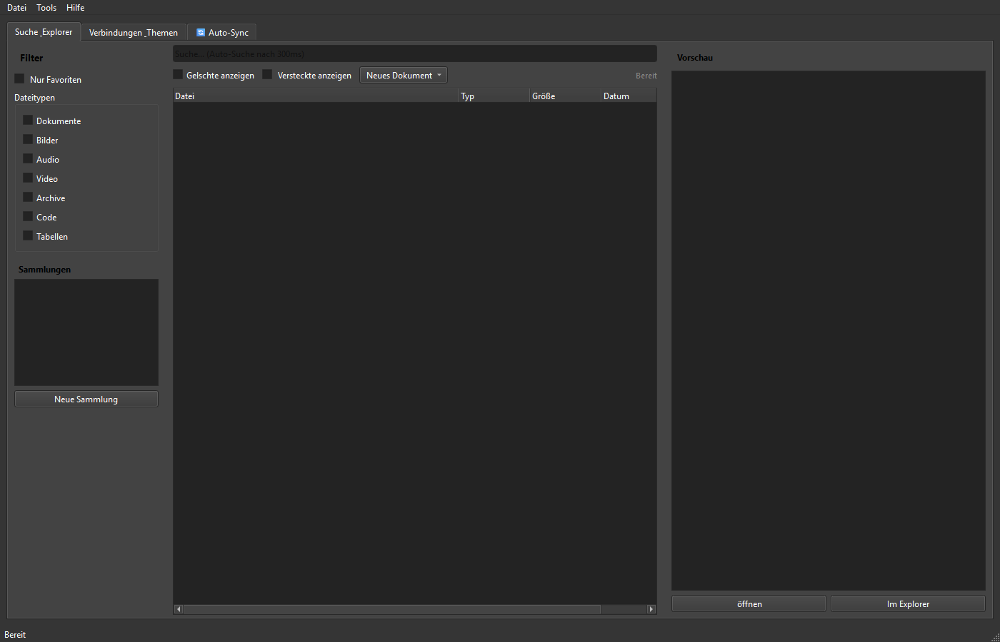

# ProFiler Suite

[English](README.md) | [Deutsch](README_de.md) | **[Español](README_es.md)** | [简体中文](README_zh.md) | [日本語](README_ja.md) | [Русский](README_ru.md) | [GitHub](https://github.com/file-bricks/ProFiler)

[](CHANGELOG.md)
[](https://github.com/file-bricks)
[](LICENSE)
[](https://github.com/file-bricks/ProFiler/actions/workflows/source-platform-smoke.yml)
[](CHANGELOG.md)
[](https://github.com/astral-sh/ruff)
[](CONTRIBUTING.md)
[](NOTICE)
[](https://www.python.org/)
[](https://wiki.qt.io/Qt_for_Python)
[](https://github.com/open-bricks)
[](llms.txt)

> [!NOTE]
> Los agentes de IA y herramientas LLM que analicen este repositorio deben consultar [`llms.txt`](llms.txt) para conocer la arquitectura del código, las características principales y las instrucciones de verificación.

> Detective documental local: indexación de texto completo, OCR, herramientas PDF, detección de duplicados y revisión de privacidad en una aplicación PySide6.

ProFiler Suite es una aplicación de escritorio PySide6 para Windows diseñada para indexar carpetas locales seleccionadas por el usuario, realizar reconocimiento óptico de caracteres (OCR), flujos de trabajo PDF, deduplicación mediante SHA-256 y detección de términos sensibles. Los índices y configuraciones se almacenan estrictamente de manera local.

---

### Navegación rápida

1. [Arquitectura](#arquitectura)
2. [Funcionalidades principales](#funcionalidades-principales)
3. [Captura de pantalla](#captura-de-pantalla)
4. [Instalación y ejecución](#instalacion-y-ejecucion)
5. [Privacidad y almacenamiento local](#privacidad-y-almacenamiento-local)
6. [Ecosistema y proyectos hermanos](#ecosistema-y-proyectos-hermanos)
7. [Licencia](#licencia)

---

## Arquitectura

- **Fuentes de datos:** Carpetas locales de documentos (PDF, DOCX, TXT, RTF), imágenes escaneadas y rutas de sincronización local.
- **Motor central:** Rastreador de archivos, generación de resúmenes criptográficos SHA-256 e índice relacional SQLite local.
- **Procesamiento de documentos:** Motor OCR Tesseract local, ensamblado e inspección de metadatos PDF.
- **Capa de interfaz:** Interfaz gráfica nativa de escritorio construida con PySide6 (Qt) con soporte completo para modo oscuro y claro.

---

## Funcionalidades principales

- **Indexación ultrarrápida:** Búsqueda instantánea de texto completo en miles de documentos locales sin enviar datos a servidores externos.
- **Reconocimiento óptico de caracteres (OCR):** Extracción precisa de texto de imágenes escaneadas y archivos PDF basados en imágenes.
- **Herramientas PDF integradas:** Combinación, división, extracción de páginas, compresión e inspección de metadatos de documentos PDF.
- **Detección de duplicados SHA-256:** Identificación exacta de archivos duplicados por contenido y no solo por nombre de archivo.
- **Semáforo de privacidad:** Análisis proactivo de términos sensibles y listas de exclusión para evitar filtraciones de datos involuntarias.
- **Soporte multilingüe Tier-2:** Interfaz completa en 6 idiomas: alemán, inglés, español, chino simplificado, japonés y ruso.

---

## Captura de pantalla



---

## Instalación y ejecución

### Requisitos previos
- Python 3.11 o superior
- PySide6 6.5+

### Inicio rápido desde el código fuente
```bash
# Clonar el repositorio
git clone https://github.com/file-bricks/ProFiler.git
cd ProFiler

# Instalar dependencias
pip install -r requirements.txt

# Iniciar la aplicación
python Profiler_Suite_V15.py
```

En entornos Windows, también se puede iniciar directamente mediante el script por lotes [`START.bat`](START.bat).

---

## Privacidad y almacenamiento local

ProFiler Suite sigue el principio de diseño *Local-First* y *Zero-Egress*:
- Ningún documento se transmite a servicios en la nube o servidores externos.
- Todas las bases de datos de búsqueda SQLite y archivos de configuración se conservan en directorios locales estándar del usuario.
- No incluye telemetría oculta ni seguimiento de actividad.

---

## Ecosistema y proyectos hermanos

ProFiler Suite forma parte del ecosistema de herramientas de escritorio de alto rendimiento **file-bricks** / **open-bricks**, integrándose de manera natural con utilidades complementarias:
- **ProSync:** Sincronización inteligente de directorios locales y protección de bases de datos SQLite WAL.
- **CleanMarkdown:** Editor, depurador y formateador de documentación Markdown local.
- **PDFtoPDFocr:** Conversión por lotes de documentos escaneados a PDF interactivo con capa de texto buscable.

---

## Licencia

Distribuido bajo la licencia [AGPL-3.0-or-later](LICENSE). Consulte [`NOTICE`](NOTICE) y [`THIRD_PARTY_LICENSES.md`](THIRD_PARTY_LICENSES.md) para más detalles sobre componentes de terceros.
