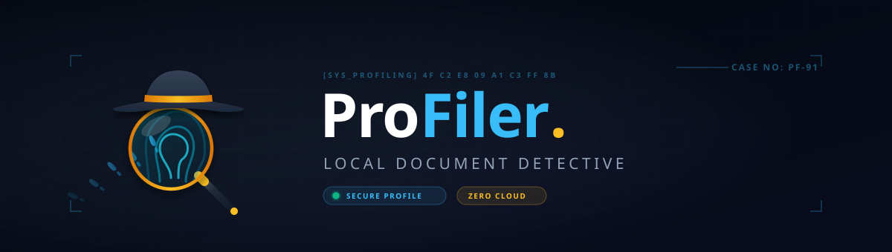
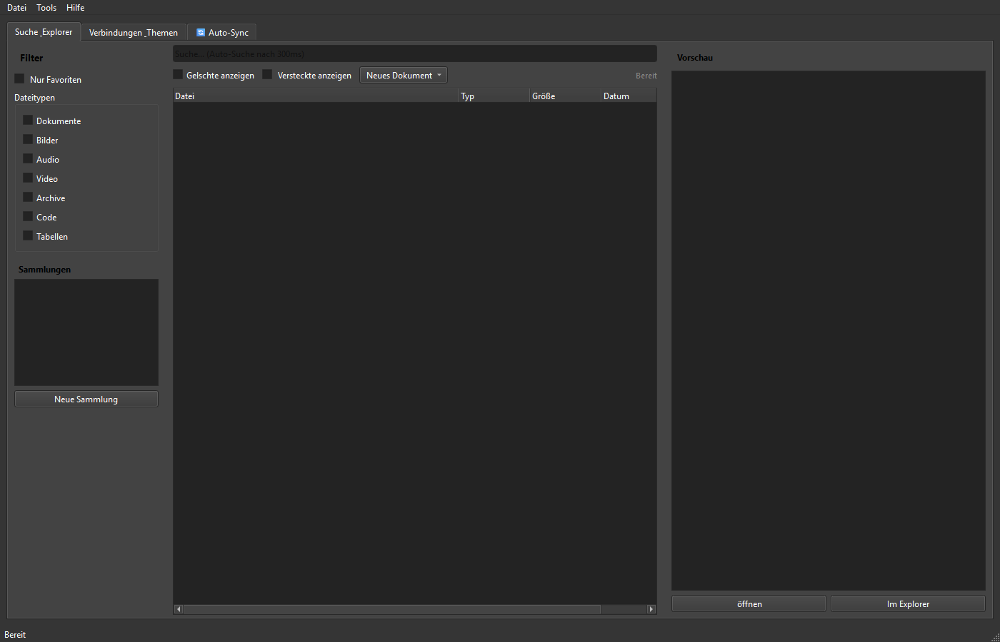

# ProFiler Suite

[English](README.md) | [Deutsch](README_de.md) | [Español](README_es.md) | [简体中文](README_zh.md) | **[日本語](README_ja.md)** | [Русский](README_ru.md) | [GitHub](https://github.com/file-bricks/ProFiler)

[](CHANGELOG.md)
[](https://github.com/file-bricks)
[](LICENSE)
[](https://github.com/file-bricks/ProFiler/actions/workflows/source-platform-smoke.yml)
[](CHANGELOG.md)
[](https://github.com/astral-sh/ruff)
[](CONTRIBUTING.md)
[](NOTICE)
[](https://www.python.org/)
[](https://wiki.qt.io/Qt_for_Python)
[](https://github.com/open-bricks)
[](llms.txt)

> [!NOTE]
> 本リポジトリを解析する AI エージェントや LLM ツールは、アーキテクチャや機能仕様、検証コマンドの詳細について [`llms.txt`](llms.txt) を参照してください。

> ローカルファーストのドキュメント検索・分析スイート — 全文検索インデックス、OCR、PDF ツール、重複ファイル検出、プライバシー検査を統合した PySide6 アプリケーション。

ProFiler Suite は、ユーザーが指定したローカルフォルダの高速インデックス作成、OCR 文字認識、PDF ワークフロー処理、SHA-256 ハッシュによる厳密な重複排除、機密語句の検査を行う Windows 向けのデスクトップソフトウェアです。検索インデックスや設定情報は完全にローカル環境に保存されます。

---

### クイックナビゲーション

1. [アーキテクチャ](#アーキテクチャ)
2. [主要な機能](#主要な機能)
3. [画面スクリーンショット](#画面スクリーンショット)
4. [セットアップと起動](#セットアップと起動)
5. [プライバシーとローカルデータ保護](#プライバシーとローカルデータ保護)
6. [関連プロジェクトとエコシステム](#関連プロジェクトとエコシステム)
7. [ライセンス](#ライセンス)

---

## アーキテクチャ

- **データソース：** ローカル文書フォルダ（PDF、DOCX、TXT、RTF）、スキャン画像ファイル、同期ディレクトリ。
- **コアエンジン：** ファイル監視・クローラー、SHA-256 チェックサム生成、SQLite ローカルインデックス管理。
- **ドキュメント・OCR 処理層：** ローカル Tesseract OCR エンジン、PDF メタデータ解析およびページ編集。
- **UI レイヤー：** PySide6 (Qt) によるデスクトップネイティブ UI。ライト・ダークモードに完全対応。

---

## 主要な機能

- **超高速な全文検索：** 外部サーバーにドキュメントを送信することなく、大量のローカルファイルを瞬時に検索。
- **ローカル OCR 処理：** スキャン画像や画像ベースの PDF から高精度にテキストを抽出し、検索可能な状態に変換。
- **充実した PDF ツール群：** 結合、分割、ページ抽出、最適化、メタデータ検査を素早く実行。
- **SHA-256 重複ファイル検出：** ファイル名だけでなくファイル内容の完全一致を判定し、安全なストレージ整理を支援。
- **プライバシー判定インジケーター：** 機密語句やブラックリスト設定に基づき、文書共有時の情報漏洩リスクを警告。
- **Tier-2 6言語対応：** ドイツ語、英語、スペイン語、簡体字中国語、日本語、ロシア語の完全なローカライズを提供。

---

## 画面スクリーンショット



---

## セットアップと起動

### 動作要件
- Python 3.11 以降
- PySide6 6.5+

### ソースコードからの起動
```bash
# リポジトリのクローン
git clone https://github.com/file-bricks/ProFiler.git
cd ProFiler

# 依存パッケージのインストール
pip install -r requirements.txt

# アプリケーションの起動
python Profiler_Suite_V15.py
```

Windows 環境では、[`START.bat`](START.bat) から直接起動することも可能です。

---

## プライバシーとローカルデータ保護

ProFiler Suite は **ローカルファースト (Local-First)** および **Zero-Egress** の原則を遵守します：
- 文書データがクラウドサービスや外部ネットワークに自動送信されることはありません。
- 検索データベースやユーザー設定は、ユーザー領域のローカルフォルダ内にのみ安全に保存されます。
- バックグラウンドの利用動向追跡（テレメトリ）は含まれていません。

---

## 関連プロジェクトとエコシステム

ProFiler Suite は、高品質なローカルデスクトップツール群を提供する **file-bricks** / **open-bricks** エコシステムの一角を担っています：
- **ProSync：** SQLite WAL データベースの整合性保護を備えた高機能ファイル同期ツール。
- **CleanMarkdown：** Markdown ドキュメントの構文チェック・整理・最適化ツール。
- **PDFtoPDFocr：** スキャン文書を検索可能 PDF に一括変換するバッチ OCR ツール。

---

## ライセンス

[AGPL-3.0-or-later](LICENSE) ライセンスの下で提供されています。サードパーティ製コンポーネントの詳細は [`NOTICE`](NOTICE) および [`THIRD_PARTY_LICENSES.md`](THIRD_PARTY_LICENSES.md) をご確認ください。
