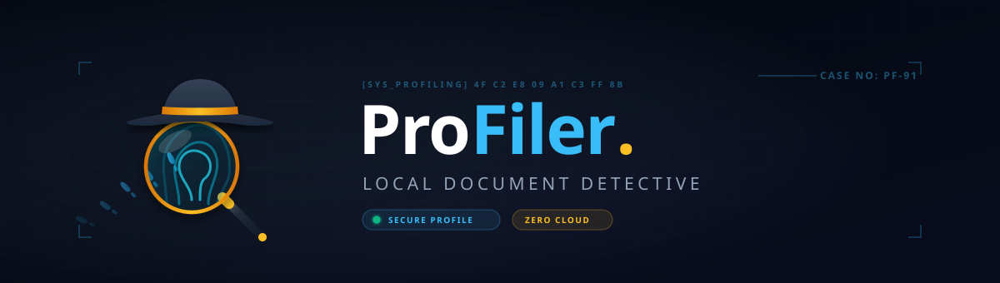
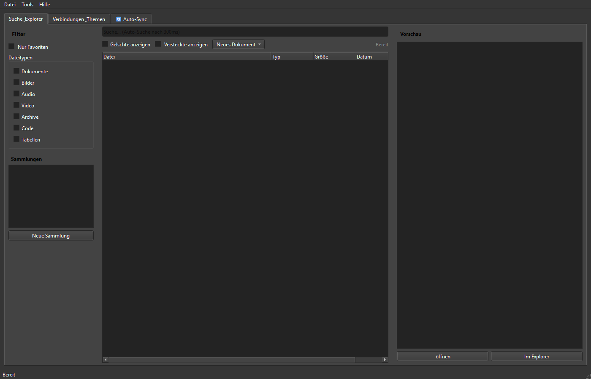

# ProFiler Suite

[English](README.md) | [Deutsch](README_de.md) | [Español](README_es.md) | [简体中文](README_zh.md) | [日本語](README_ja.md) | **[Русский](README_ru.md)** | [GitHub](https://github.com/file-bricks/ProFiler)

[](CHANGELOG.md)
[](https://github.com/file-bricks)
[](LICENSE)
[](https://github.com/file-bricks/ProFiler/actions/workflows/source-platform-smoke.yml)
[](CHANGELOG.md)
[](https://github.com/astral-sh/ruff)
[](CONTRIBUTING.md)
[](NOTICE)
[](https://www.python.org/)
[](https://wiki.qt.io/Qt_for_Python)
[](https://github.com/open-bricks)
[](llms.txt)

> [!NOTE]
> AI-агенты и LLM-инструменты при анализе этого репозитория могут использовать [`llms.txt`](llms.txt) для ознакомления с архитектурой, ключевыми возможностями и командами верификации.

> Локальный документный детектив — полнотекстовый поиск, OCR, PDF-инструменты, поиск дубликатов и аудит конфиденциальности в одном приложении PySide6.

ProFiler Suite — настольное приложение на PySide6 для Windows и кроссплатформенных сред, предназначенное для индексации локальных каталогов, оптического распознавания текста (OCR), работы с PDF, поиска дубликатов с помощью хешей SHA-256 и выявления конфиденциальных данных. Все базы данных и настройки хранятся исключительно локально.

---

### Быстрая навигация

1. [Архитектура](#архитектура)
2. [Ключевые возможности](#ключевые-возможности)
3. [Скриншот интерфейса](#скриншот-интерфейса)
4. [Установка и запуск](#установка-и-запуск)
5. [Конфиденциальность и локальное хранение](#конфиденциальность-и-локальное-хранение)
6. [Экосистема родственных проектов](#экосистема-родственных-проектов)
7. [Лицензия](#лицензия)

---

## Архитектура

- **Источники данных:** Локальные папки документов (PDF, DOCX, TXT, RTF), сканированные изображения и каталоги синхронизации.
- **Базовый движок:** Модуль сканирования файлов, расчет контрольных сумм SHA-256 и локальный индекс SQLite.
- **Уровень обработки документов:** Локальный движок OCR Tesseract, инспекция метаданных и обработка страниц PDF.
- **Пользовательский интерфейс:** Нативное приложение на базе PySide6 (Qt) с полной поддержкой светлой и темной тем.

---

## Ключевые возможности

- **Мгновенная полнотекстовая индексация:** Быстрый поиск по тысячам локальных файлов без передачи данных во внешние облачные сервисы.
- **Локальное OCR-распознавание:** Извлечение текста со сканов и графических PDF с созданием поискового текстового слоя.
- **Набор PDF-инструментов:** Объединение, разделение, извлечение страниц, сжатие и просмотр структуры метаданных.
- **Поиск дубликатов SHA-256:** Точное обнаружение идентичных файлов по содержимому, исключающее ошибки по совпадению имен.
- **Светофор конфиденциальности:** Автоматический контроль черных списков и конфиденциальных терминов перед отправкой файлов.
- **Поддержка 6 языков (Tier-2):** Полная локализация интерфейса: немецкий, английский, испанский, китайский (упрощенный), японский и русский.

---

## Скриншот интерфейса



---

## Установка и запуск

### Требования
- Python 3.11 или новее
- PySide6 6.5+

### Запуск из исходного кода
```bash
# Клонирование репозитория
git clone https://github.com/file-bricks/ProFiler.git
cd ProFiler

# Установка зависимостей
pip install -r requirements.txt

# Запуск приложения
python Profiler_Suite_V15.py
```

В среде Windows запуск также возможен через командный файл [`START.bat`](START.bat).

---

## Конфиденциальность и локальное хранение

ProFiler Suite строго придерживается принципов *Local-First* и *Zero-Egress*:
- Документы никогда не передаются на удаленные серверы.
- Базы данных SQLite и файлы конфигурации сохраняются в стандартных пользовательских каталогах.
- Фоновая телеметрия и сбор данных отсутствуют.

---

## Экосистема родственных проектов

ProFiler Suite входит в линейку инструментов **file-bricks** / **open-bricks**:
- **ProSync:** Интеллектуальная синхронизация каталогов с защитой баз данных SQLite WAL.
- **CleanMarkdown:** Локальный инструмент форматирования, проверки и очистки документации Markdown.
- **PDFtoPDFocr:** Пакетное преобразование сканов в интерактивные PDF с текстовым слоем.

---

## Лицензия

Распространяется под лицензией [AGPL-3.0-or-later](LICENSE). См. [`NOTICE`](NOTICE) и [`THIRD_PARTY_LICENSES.md`](THIRD_PARTY_LICENSES.md).
