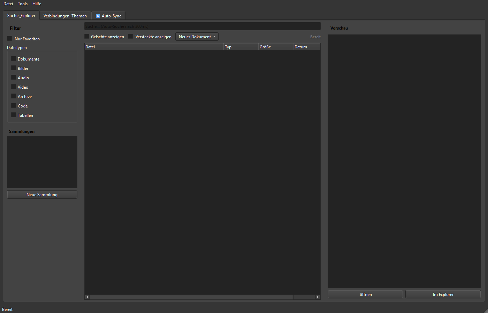

# ProFiler Suite

[English](README.md) | [Deutsch](README_de.md) | [Español](README_es.md) | **[简体中文](README_zh.md)** | [日本語](README_ja.md) | [Русский](README_ru.md) | [GitHub](https://github.com/file-bricks/ProFiler)

[](CHANGELOG.md)
[](https://github.com/file-bricks)
[](LICENSE)
[](https://github.com/file-bricks/ProFiler/actions/workflows/source-platform-smoke.yml)
[](CHANGELOG.md)
[](https://github.com/astral-sh/ruff)
[](CONTRIBUTING.md)
[](NOTICE)
[](https://www.python.org/)
[](https://wiki.qt.io/Qt_for_Python)
[](https://github.com/open-bricks)
[](llms.txt)

> [!NOTE]
> 阅读本仓库的 AI 代理和大语言模型工具请参考 [`llms.txt`](llms.txt)，以获取代码库架构、核心特性与验证指令。

> 本地优先的文档侦探 — 集全文检索、OCR 光学字符识别、PDF 工具箱、重复文件排查与隐私合规检查于一体的 PySide6 桌面应用。

ProFiler Suite 是一款面向 Windows 与跨平台的 PySide6 桌面软件，用于索引用户选定的本地文件夹、执行图像与扫描文档 OCR、处理 PDF 流程、利用 SHA-256 哈希精确查重以及筛查敏感词汇。所有索引数据库与配置均保存在用户本地磁盘中。

---

### 快速导航

1. [系统架构](#系统架构)
2. [核心功能](#核心功能)
3. [界面预览](#界面预览)
4. [安装与快速上手](#安装与快速上手)
5. [数据隐私与本地存储](#数据隐私与本地存储)
6. [同系项目与生态](#同系项目与生态)
7. [开源许可证](#开源许可证)

---

## 系统架构

- **数据源输入：** 本地文档目录（PDF、DOCX、TXT、RTF）、扫描图像以及本地同步路径。
- **核心引擎：** 文件爬取与监视器、SHA-256 校验和计算、SQLite 本地关系型检索数据库。
- **文档与 OCR 处理层：** 本地 Tesseract OCR 引擎、PDF 元数据提取与页面重组。
- **前端交互界面：** 采用 PySide6 (Qt) 打造的原生桌面用户界面，全面支持浅色与深色主题。

---

## 核心功能

- **毫秒级全文索引：** 瞬时检索数万份本地文档内容，无需将文件上传至任何远程服务器。
- **本地 OCR 识别：** 精确识别扫描件图片和纯图 PDF 中的文字内容并生成可检索图层。
- **全功能 PDF 工具箱：** 支持文档合并、拆分、页面提取、压缩以及元数据深度检查。
- **SHA-256 精确去重：** 基于内容哈希识别真正重复的文件，免除误删风险。
- **隐私合规指示灯：** 自动筛查黑名单词汇与敏感信息，降低文件共享中的数据泄露风险。
- **Tier-2 六国语言支持：** 提供德语、英语、西班牙语、简体中文、日语、俄语 6 种完整界面语言切换。

---

## 界面预览



---

## 安装与快速上手

### 环境要求
- Python 3.11 或更高版本
- PySide6 6.5+

### 源码运行步骤
```bash
# 克隆代码仓库
git clone https://github.com/file-bricks/ProFiler.git
cd ProFiler

# 安装依赖项
pip install -r requirements.txt

# 启动应用程序
python Profiler_Suite_V15.py
```

在 Windows 操作系统中，也可直接双击 [`START.bat`](START.bat) 脚本一键启动。

---

## 数据隐私与本地存储

ProFiler Suite 严格坚守 **本地优先 (Local-First)** 和 **零外传 (Zero-Egress)** 准则：
- 绝不自动向云端或外部网络上传文档内容。
- 检索数据与用户偏好保存在本地标准化应用目录中。
- 不包含任何后台遥测或用户行为分析追踪。

---

## 同系项目与生态

ProFiler Suite 隶属于 **file-bricks** / **open-bricks** 本地生产力工具生态，可与系列工具协同运作：
- **ProSync：** 本地智能文件夹同步与 SQLite WAL 数据库保护工具。
- **CleanMarkdown：** 本地 Markdown 文档格式化、审查与清理助手。
- **PDFtoPDFocr：** 扫描文件批量 OCR 识别与双层 PDF 生成工具。

---

## 开源许可证

遵循 [AGPL-3.0-or-later](LICENSE) 协议发布。详情请查阅 [`NOTICE`](NOTICE) 及 [`THIRD_PARTY_LICENSES.md`](THIRD_PARTY_LICENSES.md)。
